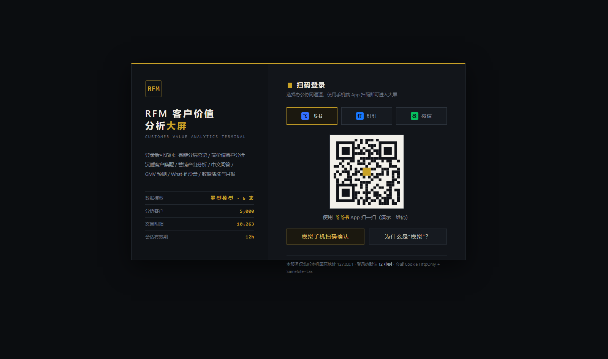
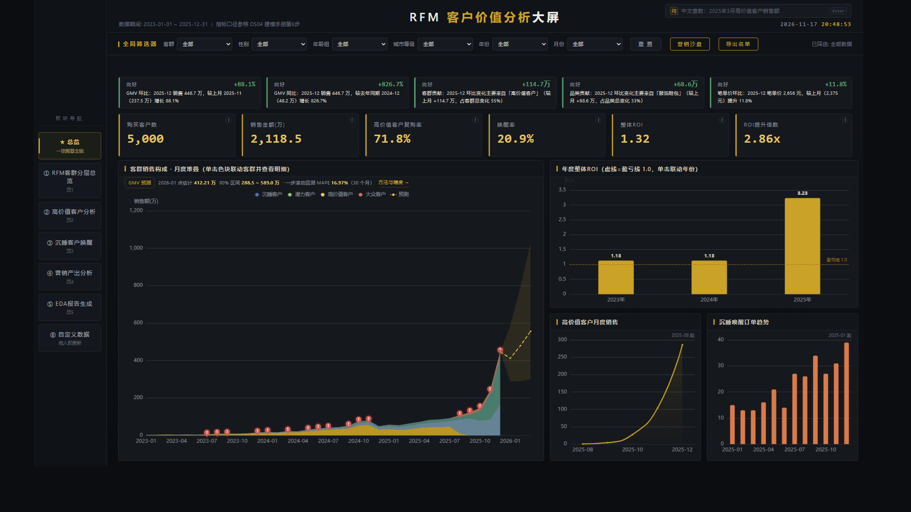

# RFM 客户价值分析可视化大屏

基于 **Flask + ECharts + pandas** 的电商 RFM 客户分析系统（1920×1080 投屏设计）。
覆盖 RFM 客群分层、高价值客户分析、沉睡客户唤醒、营销产出四大分析主题，
并附带数据清洗引擎、EDA 报告生成、中文问答、GMV 预测与 What-if 沙盘等进阶模块。

> **数据保密声明**：本项目源自真实电商业务，原始业务数据受保密协议约束无法公开。
> 仓库中的 `data/` 示例数据由 [`gen_sample_data.py`](gen_sample_data.py) 按相同表结构
> 与相同 RFM 口径程序化生成（seed 固定、可复现），不含任何真实客户信息。

## 快速开始

```bash
pip install -r requirements.txt
python gen_sample_data.py      # 生成 6 张脱敏示例 CSV（data/ 目录）
python dashboard_app.py        # 启动服务
# 浏览器访问 http://127.0.0.1:5000 → 扫码登录页 → 模拟扫码确认进入
```

## 功能总览

| 模块 | 说明 |
|------|------|
| 四页分析大屏 | RFM 客群分层 / 高价值客户 / 沉睡唤醒 / 营销产出，全局筛选器 + 图表点击联动 + 下钻 |
| 数据清洗引擎 | 可配置规则引擎（`rules_config.json`）：金额标准化、三色分流（绿直接通过/黄人工复核/红剔除）、去重、退款口径 |
| EDA 报告生成 | matplotlib 延迟加载，按客群/品类/年份一键生成 PDF |
| 中文问答 ChatBI | 纯规则解析器（零依赖、永不 500），双口径消歧 |
| GMV 预测 | 对数空间阻尼 Holt 指数平滑，三重质量门控（数据量/波动性/滞后性） |
| What-if 沙盘 | 成本口径 = 让利成本 + 触达成本，ROI 仅作横向比较 |
| 扫码登录 | 飞书 / 钉钉 / 微信三通道，演示模式离线可用，预留 OAuth 对接 |
| 本地 LLM 意图解析 | 默认关闭；仅解析意图不出数，回环白名单 + 熔断器 |

## 项目结构

```
dashboard_app.py        # Flask 后端主程序（数据加载/指标计算/筛选联动/下钻/EDA）
login_auth.py           # 登录鉴权（会话管理 + 三通道扫码 + 访问口令）
ask_parser.py           # 中文问答规则解析器
llm_slots.py            # 本地 LLM 意图解析（默认关闭）
clean_engine.py         # 数据清洗引擎（三色分流 + SQLite 审计日志）
eda_report_gen.py       # EDA 报告生成
gen_sample_data.py      # 脱敏示例数据生成器（固定种子可复现）
rules_config.json       # 清洗规则配置（改配置即改规则，无需改代码）
templates/  static/     # 墨金终端主题前端（1920×1080）
test_*.py               # 54 项单元测试（pytest 风格断言）
```

## 安全设计

- 服务默认仅监听 `127.0.0.1`；公开部署时通过环境变量 `PORT` 适配并配合访问口令；
- 会话 Cookie HttpOnly + SameSite=Lax，签名密钥自动生成持久化；
- 二维码 ticket 一次性、限时过期、用后即焚；
- 路径白名单校验（防目录穿越）、上传 JSON 序列化（防反序列化）、前端输出 HTML 转义。

## 测试

```bash
python test_ask_parser.py     # 25 项
python test_llm_slots.py      # 29 项
python test_parse_tabular.py
```

## 截图

| 登录页 | 大屏总览 |
|--------|----------|
|  |  |
